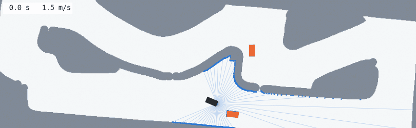
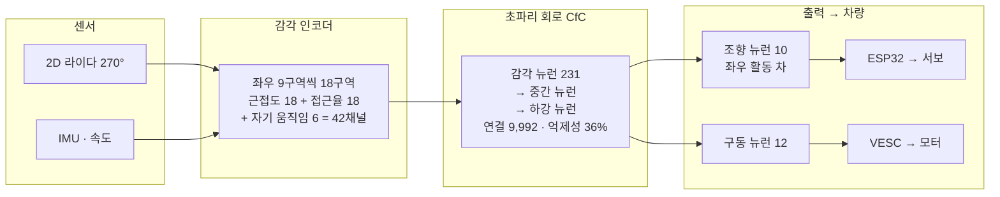
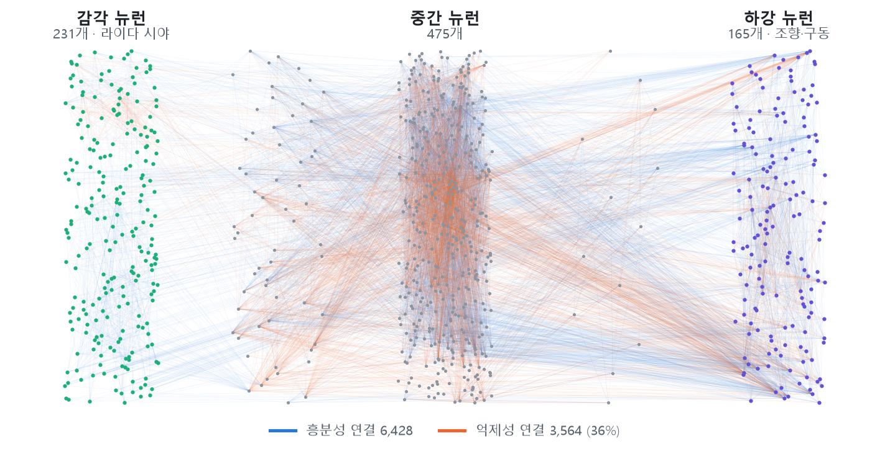
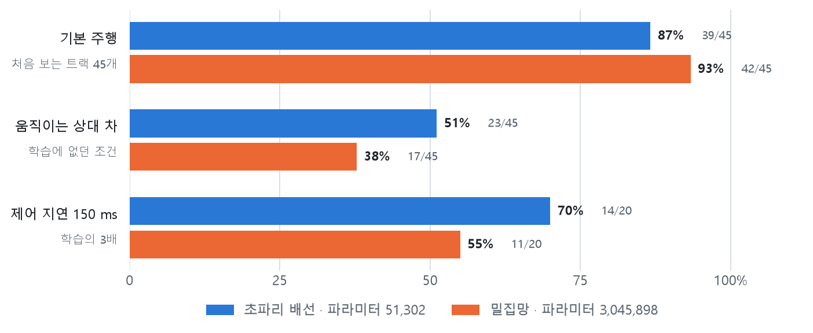
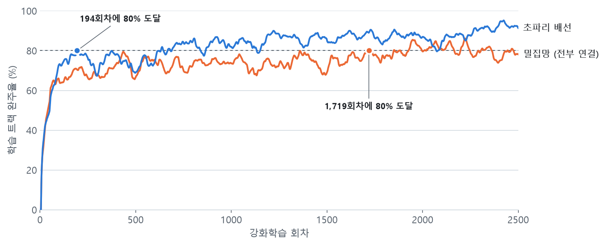
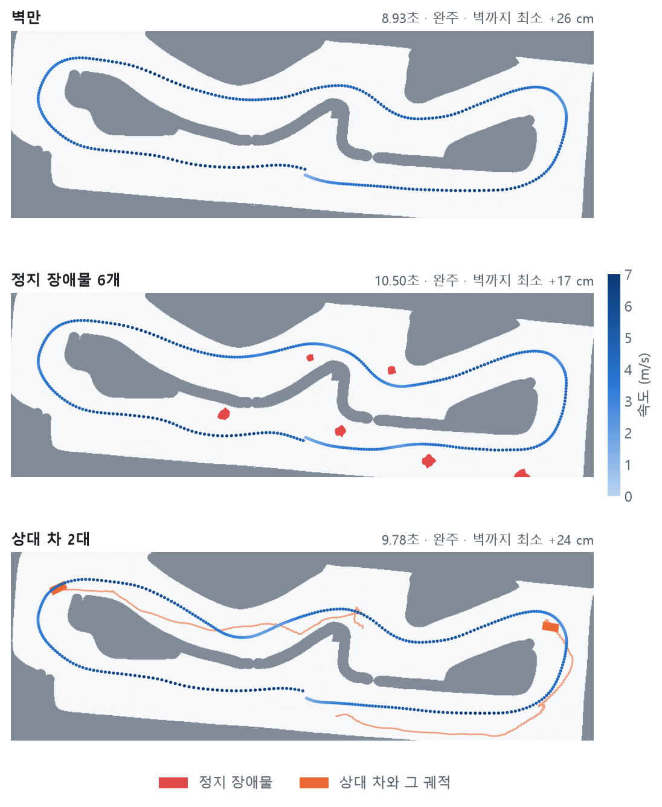
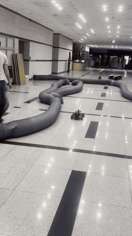
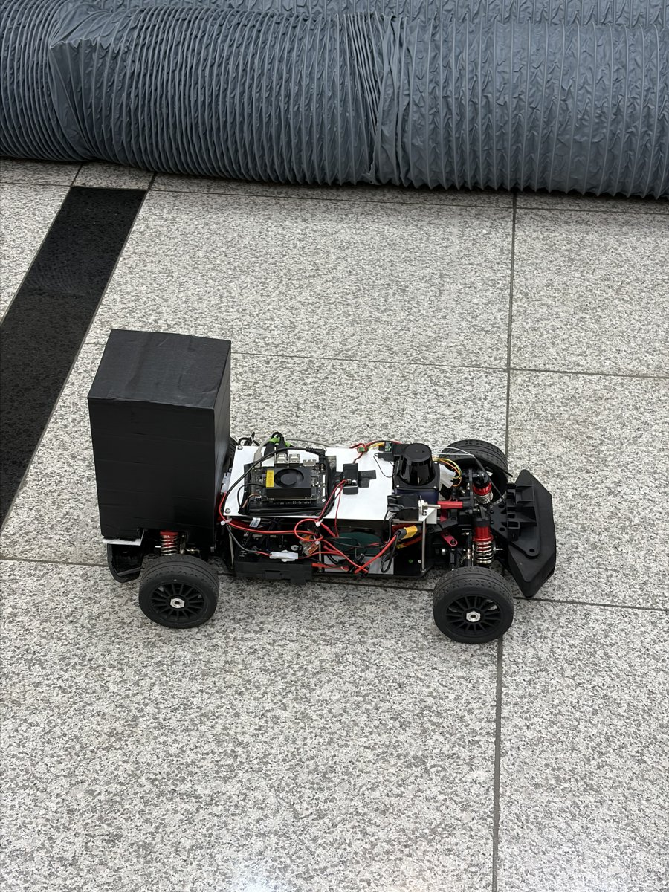

# Fruit Fly Brain Reinforcement Learning

**초파리 커넥톰 배선을 이식한 1:10 자율주행 레이싱카 제어기**
생물 신경회로 추출 → 시뮬레이터 직접 구현 → 모방·강화학습 → 실차 주행까지


아주대학교 기계공학과 · ROBORACER 2026 출전팀 · 연구 기간 2026. 9. 19 ~ 2026. 10. 1
📄 [연구 보고서 (PDF)](docs/research_report.pdf)

<p align="center">
  <picture>
    <source media="(prefers-color-scheme: dark)" srcset="docs/images/drive_dark.gif">
    
  </picture>
  <br>
  <sub>학습에 쓰지 않은 2026 대회 코스를 초파리 회로가 지도 없이 라이다(파랑)만 보고 달린다. 주황은 상대 차. 실제 속도로 재생. <a href="#3-실차-주행-2026-10-1">실차 주행 영상 보기 ↓</a></sub>
</p>

| 뉴런 871개 · 연결 9,992개 | 대회 코스 21/21 완주 | 파라미터 59배 적게 |
|:---:|:---:|:---:|
| 초파리 뇌 배선을 그대로 사용 | 평균 9.15초, 벽까지 최소 +22.8 cm | 밀집망 3,045,898 → 초파리 51,302 |

---

## 연구 질문

> 진화가 만든 생물의 신경 배선을 그대로 가져다 쓰면, 사람이 설계한 인공 신경망보다 나은 제어기가 되는가?

같은 뉴런 871개로 **초파리 배선**과 **전부 연결한 밀집망**을 똑같은 조건에서 학습시켜 비교했다.
학습한 조건에서는 밀집망이 조금 앞섰고, **학습에서 보지 못한 조건**(상대 차, 센서 고장, 제어 지연)에서는 초파리 배선이 앞섰다.

## 한눈에 보기

- 초파리 수컷 중추신경계 커넥톰(**neuPrint male-cns v1.0**)에서 시각 입력부터 조향·구동 출력까지 이어지는 회로를 추출
- 연결 유무와 흥분·억제 극성은 생물 그대로 고정하고 **연결 세기만 학습**하는 순환 신경망(CfC)으로 변환
- **지도·위치추정 없이** 2D 라이다 + IMU만 보고 조향과 속도를 직접 출력
- ROBORACER(구 F1TENTH) 규격 시뮬레이터를 직접 구현. 차체 형상, 조향각, 타이어 마찰, 서보 속도, 제어 지연 반영
- 레이싱 라인 교사 모방학습(DAgger) → 강화학습(PPO). 대회 코스는 학습에 쓰지 않고 시험에만 사용
- 시뮬레이터에서만 학습한 모델을 **Jetson Xavier NX에 올려 실차 주행 성공**

## 시스템 구성



<p align="center"><picture>
    <source media="(prefers-color-scheme: dark)" srcset="docs/images/circuit_dark.png">
    
  </picture></p>

- **입력**: 커넥톰 시냅스의 겹눈 육각 좌표로 시각 뉴런 231개를 라이다 시야 구역에 배정 (근접도 LC9 등, 접근 감지 LC4·LPLC2, 광역 운동 LPT/HS)
- **출력**: 조향 뉴런 10개(DNa01·02·03, DNb06, DNg13) + 구동 뉴런 12개(DNg100, DNp09, DNb08, MDN). 초파리처럼 좌우 활동 차이로 조향
- **Dale의 법칙**: 학습 중에도 연결 극성이 뒤집히지 않도록 고정. 학습 전에 배선 수·극성 유지율을 검사해 하나라도 어긋나면 학습을 시작하지 않음

## 주요 결과

### 1. 초파리 배선 vs 밀집 신경망 — 뉴런 수는 같고 배선만 다르다

**조건별 완주율** — 학습한 조건에서는 밀집망, 학습에서 못 본 조건에서는 초파리 배선이 앞섰다

<p align="center"><picture>
    <source media="(prefers-color-scheme: dark)" srcset="docs/images/wiring_compare_dark.png">
    
  </picture></p>

**강화학습 수렴 속도** — 학습 트랙 완주율, 50회차 이동평균

<p align="center"><picture>
    <source media="(prefers-color-scheme: dark)" srcset="docs/images/learning_curve_dark.png">
    
  </picture></p>

<sub>완주율 80% 도달 회차는 50회차 이동평균 기준이다. 이동평균 창을 25회차로 잡으면 169 vs 429회차로, 차이의 크기는 창에 따라 달라진다. 초파리 배선이 먼저 도달한다는 방향은 같다.</sub>

| 측정 | C (초파리 배선) | B (전부 연결) |
|:---|:---:|:---:|
| 기본 주행 완주 (45트랙) | 39 | **42** |
| 움직이는 상대 차 있을 때 완주 | **23** | 17 |
| 학습 범위 밖 센서 고장 우세 조건 (12개 중) | **9** | 1 |
| 제어 지연 150 ms (학습의 3배) 완주 | **14/20** | 11/20 |
| 모방학습 최종 오차 | **0.0027** | 0.0065 |
| 강화학습 완주율 80% 도달 | **194회차** | 1,719회차 |
| 조향 떨림 | **0.017~0.022** | 0.027~0.039 |
| 실사용 파라미터 | **51,302** | 3,045,898 (59배) |

### 2. 2026 대회 코스 — 학습에 쓰지 않은 맵

<p align="center"><picture>
    <source media="(prefers-color-scheme: dark)" srcset="docs/images/race_course_dark.png">
    
  </picture></p>

| 측정 | T안 (최종) | R안 (이전 최고) |
|:---|:---:|:---:|
| 대회 코스 (노면 7종 × 섭동 3단계) | **21/21, 평균 9.15초** | 21/21, 9.61초 |
| 대회 코스 최소 여유 (벽까지) | **+22.8 cm** | +1.3 cm |
| 일반 45트랙 × 섭동 7단계 | **45.0 ± 0.0** | 42.3 ± 1.2 |
| 조향 떨림 | **0.013** | 0.104 |

### 3. 실차 주행 (2026. 10. 1)

<table>
  <tr>
    <td align="center" width="50%"></td>
    <td align="center" width="50%"></td>
  </tr>
  <tr>
    <td align="center"><sub>종이 상자 장애물을 피해 지나가는 장면 (소리 없음) · <a href="docs/media/real_drive.mp4">고화질 MP4</a></sub></td>
    <td align="center"><sub>1:10 실차 — Jetson Xavier NX, 2D 라이다, VESC, ESP32</sub></td>
  </tr>
</table>

시뮬레이터에서만 학습한 최종 모델을 **Jetson Xavier NX**에 이식해 실차 주행 시험을 마쳤다. 오른쪽 바퀴 너클이 부서져 바퀴가 흔들리는 상태에서도 정상 주행했다.
기존 팀 스택의 경로 추종·지도·위치추정 노드 대신 **노드 하나**([`deploy/fly_drive_node.py`](deploy/fly_drive_node.py))가 라이다를 받아 바로 조향·구동 명령을 낸다.

## 기술적 문제 해결

숫자를 의심하고 다시 재면서 찾아낸 문제들이다. 자세한 기록은 커밋 메시지에 남겨 두었다.

**한 번 잰 완주율은 믿을 수 없었다**
이전 최고 모델(R안)은 45트랙 중 44개를 완주한 것으로 보였다. 그런데 행동에 부동소수점 1비트(1e-15) 섭동만 줘도 42개로 떨어졌다. 뒤집히는 트랙 5개는 벽까지 여유가 6 cm 미만인 트랙 5개와 정확히 일치했다.
→ 완주율을 섭동 7회 평균으로 재도록 평가를 바꾸고(42.6 ± 1.1), 최종 모델은 **여유 자체**를 목표로 다시 설계해 +1.3 cm → +22.8 cm로 늘렸다.

**초파리 극성이 학습 중에 씻겨 나가고 있었다**
실효 가중치 = 가중치 × 극성 마스크인데, 가중치가 양수·음수 반반으로 초기화돼 마스크를 곱해도 부호가 반반이었다. 학습 중인 모델을 재 보니 억제성 연결 3,564개 중 50.5%가 흥분성으로 뒤집혀 있었다.
→ 가중치를 0 이상으로 붙들어 극성 유지율을 59.9% → 100%로 만들고, 99.9% 미만이면 학습을 시작하지 않는 검사를 넣었다.

**제어 지연이 설정값의 절반만 걸려 있었다**
`deque(maxlen=…)`는 가득 찬 상태에서 넣을 때 앞쪽을 먼저 버린다. 그래서 50 ms로 설정한 지연이 실제로는 25 ms였다. 실차보다 반응이 빠른 세상에서 배우면 실차에서 핸들이 떤다.
→ 수정 후 명령 2스텝(50 ms)째에 바퀴가 움직이는 것을 확인했다.

**센서 손상 기능이 IMU를 잘라 먹고 있었다**
도메인 랜덤화로 라이다를 망가뜨린 뒤 관측을 다시 붙이는 코드가 IMU 3개 중 1개만 남기고 있었다. 강화학습 내내 IMU 두 개가 없는 관측으로 학습한 셈이다.
→ 수정하고, 실제 1:10 차처럼 가속도계 진동과 에피소드마다 고정되는 자이로 영점 오차를 넣었다.

**시뮬레이터 개선 폭을 실차 명령 경로로 다시 쟀다**
추월 층(Y안)은 시뮬에서 상대 차 충돌을 49% 줄였다. 하지만 실차의 서보 지연과 모터 duty 변환을 그대로 태워 다시 재니 **-27%** 였다.
→ 문서의 수치를 실차 기준으로 통일하고, 상대 차가 없을 때는 오히려 12.5% 느려진다는 점도 함께 남겼다.

## 모델 계보

| 이름 | 배선 | 학습 | 결과 |
|---|---|---|---|
| C안 | 초파리 | 고전 교사 모방 + 강화학습 | 첫 초파리 모델, 대회 코스 12.2초 첫 완주 |
| B안 | 전부 연결(밀집) | C안과 동일 조건 | 대조군 — 정적 우세, 동적 열세 |
| R안 | 초파리 | 레이싱 교사 + 강화학습 | 속도 향상, 조향 떨림·얇은 여유 문제 |
| **T안** | 초파리 | 대회형 트랙 + CAPS + 곱셈 보상 + DAgger + 강화학습 3000회차 | **최종 모델, 실차 주행** |
| Y안 | T안 + 추월 층 | 재학습 없음 | 상대 차 충돌 -27%, 랩타임 +10% → 선택 사항 |

## 개발 환경

| 항목 | 내용 |
|---|---|
| 데이터 | neuPrint male-cns v1.0 (초파리 수컷 중추신경계 커넥톰) |
| 학습 장비 | 노트북 AMD Ryzen 7 8845HS, RAM 32 GB, GPU 없이 CPU 학습 |
| 실차 | 1:10 차량, Jetson Xavier NX, SLAMTEC 2D 라이다, EBIMU, VESC, ESP32 조향 서보 |
| 소프트웨어 | Python, PyTorch, ncps(CfC), ROS2, 자체 구현 시뮬레이터 |
| 규모 | 최종 모델 학습 14시간 11분(3000회차), 설정 선정 평가 주행 3,708회 |

## 설치와 실행

```bash
python -m venv .venv
.venv\Scripts\activate        # macOS/Linux: source .venv/bin/activate
pip install -r requirements.txt

# README 그림 다시 만들기 (docs/images/)
python tools/make_figures.py circuit curve compare
```

평가 스크립트는 저장소 **옆 폴더**에서 대회 맵(`../ifac_roboracer_maps/`)과 F1TENTH 공개 서킷(`../f1tenth_racetracks/`, [GitHub](https://github.com/f1tenth/f1tenth_racetracks))을 찾는다. 위치를 바꾸려면 환경 변수 `FLYRACER_RACE_MAP`, `FLYRACER_F1TENTH_TRACKS`를 쓰면 된다.
학습된 가중치(`*.pt`)와 실험 산출물(`outputs/`, `logs/`)은 용량 때문에 저장소에 넣지 않았다. 실행 명령과 파일별 설명은 [코드 안내서](docs/CODE_GUIDE.md)에 있다.

## 폴더 구성

| 폴더 | 내용 |
|---|---|
| [`flyracer/`](flyracer/) | 핵심 패키지. 시뮬레이터(`sim`), 초파리 회로·CfC 신경망(`brain`), 레이싱 라인·교사·추월 층(`drive`) |
| [`train/`](train/) | 학습. 모방학습(DAgger) → 강화학습(PPO) |
| [`evaluate/`](evaluate/) | 성적 측정과 실험. 완주율, 센서 고장, 제어 지연, 상대 차, 대회 코스, 최종 모델 선정 |
| [`view/`](view/) | 주행 뷰어와 궤적 그림 |
| [`deploy/`](deploy/) | 실차 이식. Jetson용 주행 노드, ESP32·VESC 통신, 실차 경로 검증 |
| [`data/`](data/) | neuPrint에서 받은 회로 데이터. 최종 회로 뉴런 871개, 연결 9,992개 |
| [`models/`](models/) | 모델별 성적표(JSON) |
| [`tools/`](tools/) | 회로 데이터 받기·추리기, 학습 전 점검, README 그림 생성 |
| [`scripts/`](scripts/) | 학습·실험 진행 상황 보기, 체크포인트 보관 |
| [`archive/`](archive/) | 초기 검증용 1회성 스크립트 (기록용) |
| [`docs/`](docs/) | 연구 보고서 PDF, 코드 안내서, README 그림 |

폴더마다 README가 있어 폴더를 열면 파일별 설명이 보인다.

## 한계와 향후 과제

- 시뮬레이터 매개변수 일부(타이어 마찰, 제어 지연)는 실측이 아닌 문헌값
- 추월 자체에 보상을 준 재학습은 아직 미진행
- 회로 추리 과정에서 접근 감지 세포 445개 중 25개만 남음 → 회로 확장 여지
- 배선 비교(B·C)는 각 한 번씩 학습 — 난수 시드 반복과 무작위 희소 배선 대조군 필요

## 주요 참고문헌

- Berg, S. et al. (2026). Sexual dimorphism in the complete *Drosophila* male central nervous system connectome. *Cell*. — neuPrint male-cns v1.0
- Lechner, M. et al. (2020). Neural circuit policies enabling auditable autonomy. *Nature Machine Intelligence*.
- Hasani, R. et al. (2022). Closed-form continuous-time neural networks. *Nature Machine Intelligence*.
- Schulman, J. et al. (2017). Proximal policy optimization algorithms. arXiv:1707.06347.
- O'Kelly, M. et al. (2020). F1TENTH: An open-source evaluation environment for continuous control and reinforcement learning. PMLR 123.

전체 참고문헌 29편은 [연구 보고서](docs/research_report.pdf)에 있다.
